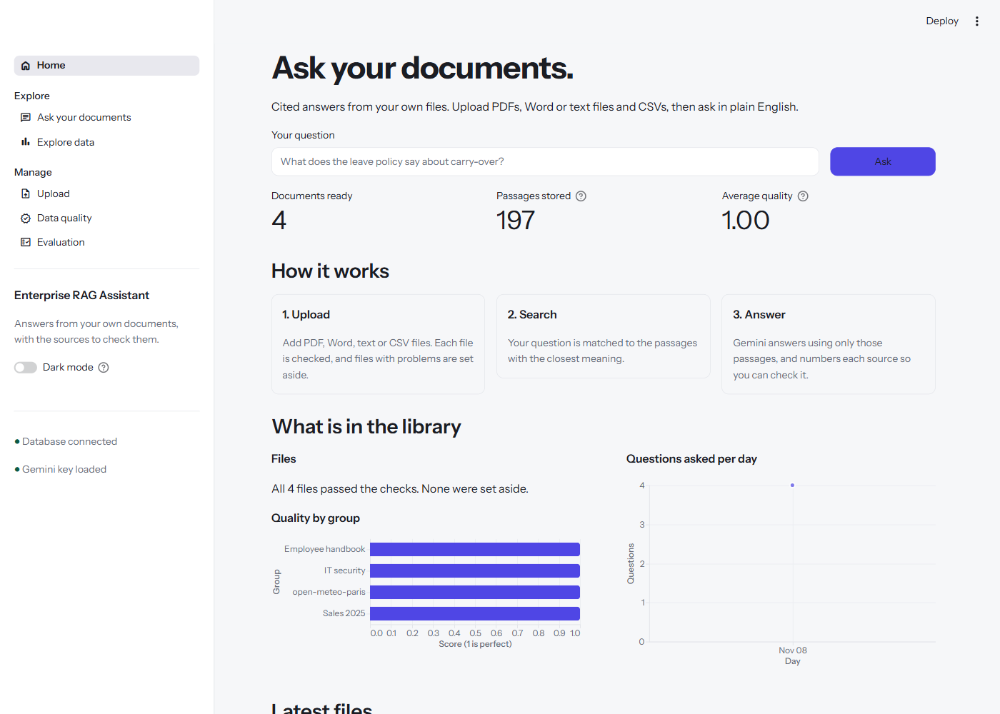
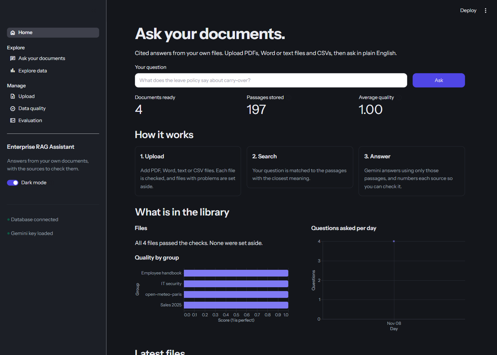
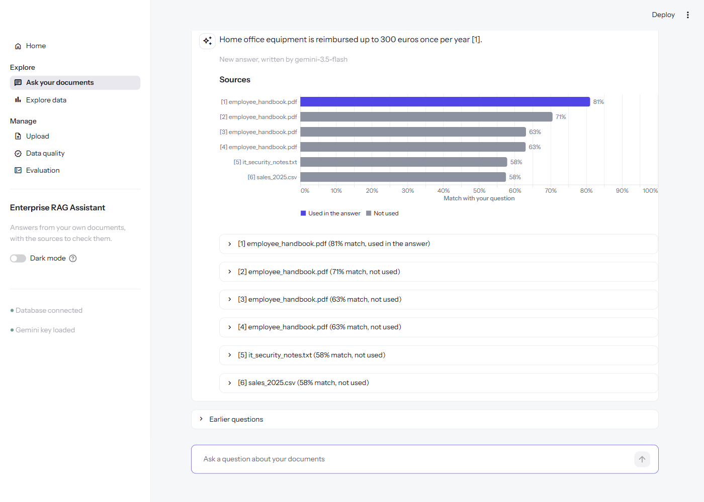
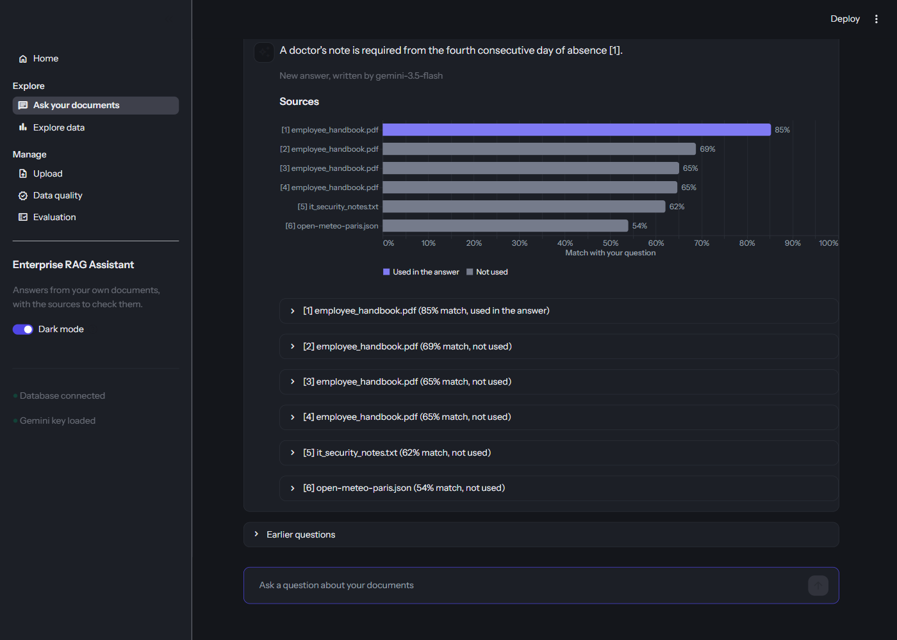

# Enterprise RAG Assistant

Ask questions about your own documents and get answers with numbered sources you can check.
Upload PDFs, Word files, text files or CSVs, then ask in plain English. The app finds the
passages that match your question and has Google Gemini answer **only** from those passages.
If the documents don't contain the answer, it says so instead of guessing.

| Light | Dark |
|---|---|
|  |  |
|  |  |

## What you can do

| Page | What it is for |
|---|---|
| **Home** | Ask a question straight away, and see what is in the library at a glance. |
| **Ask your documents** | A chat. Each answer cites its sources as [1], [2]; a chart shows how closely each source matched and which ones the answer used. |
| **Explore data** | Summaries, charts and filters for an uploaded CSV, with a download of the filtered rows. No AI here, so the numbers are exact. |
| **Upload** | Add files, or fetch live weather data. Every file is checked first; files with problems are set aside with the reason. |
| **Data quality** | A 0-to-1 quality score for every group of files, its history, and the files that were set aside. |
| **Evaluation** | Save test questions with the source that should answer them, then check that search still finds it. |

A switch in the sidebar changes between a light and a dark look.

## How it works

1. **Upload.** The file is read and checked: enough readable text, no empty or repeated rows.
   Email addresses and phone numbers are replaced with `[EMAIL]` and `[PHONE]`.
2. **Split.** Documents are cut into short passages (CSV files: one passage per row).
3. **Store.** Gemini turns each passage into a list of numbers that captures its meaning.
   These are saved in a Postgres database (Supabase, with the pgvector extension).
4. **Search.** Your question is turned into numbers the same way, and the database returns
   the passages with the closest meaning.
5. **Answer.** Gemini writes the answer using only those passages and cites them.
   A repeated question reuses the saved answer, until new files are added.

## Built with

Python, [Streamlit](https://streamlit.io) (the web pages), [Google Gemini](https://ai.google.dev)
(meaning and answers), [Supabase](https://supabase.com) Postgres with pgvector (storage and search),
pandas and Altair (tables and charts), PyMuPDF and python-docx (reading PDF and Word files).

## Run it on your computer

You need Python 3.11, a free [Supabase](https://supabase.com) project and a free
[Gemini API key](https://aistudio.google.com/apikey).

1. **Get the code and install it**
   ```bash
   git clone <your-repo-url>
   cd Enterprise-RAG-Assistant
   python -m venv .venv
   .venv\Scripts\activate          # Windows
   source .venv/bin/activate       # macOS / Linux
   pip install -r requirements.txt
   ```
2. **Create the database tables.** In Supabase, open the SQL editor and run the three files in
   `sql/` in order: `001_init.sql`, `002_match_chunks.sql`, `003_jobs_and_cache.sql`.
3. **Add your keys.** Create a file named `.env` in the project folder:
   ```
   DATABASE_URL=postgresql://...
   GEMINI_API_KEY=...
   ```
   For `DATABASE_URL`, open your Supabase project, click **Connect**, and copy the
   **Session pooler** connection string (it ends in `:5432/postgres`). The "Direct"
   string does not work from Streamlit Cloud.
   `.env` is ignored by git, so your keys are never uploaded.
4. **Start the app**
   ```bash
   streamlit run app.py
   ```
   It opens at http://localhost:8501. Start on the **Upload** page.

## Put it online (Streamlit Community Cloud, free)

1. Push the project to GitHub (without `.env`).
2. On [share.streamlit.io](https://share.streamlit.io), choose **Create app**, pick the
   repository, and set the main file to `app.py`.
3. Under **Advanced settings**, choose Python 3.11 and paste your keys into **Secrets**,
   at the top level (not under a heading):
   ```toml
   DATABASE_URL = "postgresql://..."
   GEMINI_API_KEY = "..."
   ```
4. Deploy. Streamlit passes top-level secrets to the app the same way as `.env`.

## Good to know

- **Anyone with the link can use it.** Everyone shares one library and one Gemini quota.
- **Big files take time.** The free Gemini plan handles about 100 passages a minute.
  The app waits and carries on by itself, so a large CSV can take a few minutes.
- **Explore data forgets CSVs after a restart** on Streamlit Cloud, because the host wipes the
  upload folder. The documents stay searchable; upload the CSV again to chart it.
- **Citations name the file and passage, not the page number.**
- **Dark mode** covers everything except the large scrollable table on Explore data,
  which Streamlit always draws in light colors.

## Project layout

```
app.py              starts the app: theme, sidebar, list of pages
views/              one file per page (home, documents_qa, data, upload, quality, evaluation)
core/               the work behind the pages
  ingest.py         check, split, embed and save files and API data
  ask.py            answer a question with sources (and reuse saved answers)
  retrieve.py       find the closest passages
  embed.py          text to numbers with Gemini
  generate.py       ask Gemini to write the answer
  db.py             talk to the database
  evals.py          test search with saved questions
utils/              theme (light/dark), charts and small page helpers
sql/                database tables and the search function
tests/              automatic checks
```

## Tests

```bash
pytest
```

The tests use stand-ins for the database and Gemini, so they run offline, cost nothing,
and need no `.env` file.
